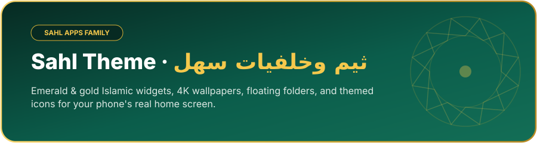

  

---

## ✨ Highlights

| Feature | What it gives you |
|---|---|
| 🎨 **4K Sahl Wallpapers** | Four procedural emerald & gold themes (Emerald Girih, Doha Dusk, Daylight Cream, Qibla Horizon) plus a Prayer Sky Live Wallpaper. |
| 🕰️ **Analog & Digital Clocks** | Classic 2×2 emerald & gold analog clock with 24h digital dial, plus a 4×2 digital clock with Hijri & Gregorian dates. |
| 🕌 **Islamic Sanctuary & Union Hub** | Daily Quranic Ayah, Morning & Evening Adhkar, and live Next Prayer countdown right on your home screen. |
| ✨ **Badgeless Icons & Popups** | Wrap any app in Sahl's emerald & gold seal without corner badges, or pin floating Sahl App folders with live notification counts. |

---

## 📲 Install in Seconds

1. Tap **[Download Latest APK](https://github.com/AliSherif1309/SahlHome/releases/latest)** above.
2. Open the downloaded `.apk` file on your Android phone to install.
3. **Sahl Theme** checks for new versions automatically so you stay up to date in one tap.

---

## 🌿 The Sahl Apps Family · عائلة تطبيقات سهل

A calm, ad-free, bilingual (**Arabic & English**) suite of everyday Android apps crafted in **Emerald & Gold**:

[🕌 Sahl Adhan](https://github.com/AliSherif1309/SahlAdhan) · [🧭 Sahl Qibla](https://github.com/AliSherif1309/SahlQibla) · [📞 Sahl Phone](https://github.com/AliSherif1309/SahlPhone) · [👤 Sahl Contacts](https://github.com/AliSherif1309/SahlContacts) · [💬 Sahl Messages](https://github.com/AliSherif1309/SahlMessages) · [📷 Sahl Camera](https://github.com/AliSherif1309/SahlCamera) · [🖼️ Sahl Gallery](https://github.com/AliSherif1309/SahlGallery) · [📁 Sahl Files](https://github.com/AliSherif1309/SahlFiles) · [📄 Sahl PDF](https://github.com/AliSherif1309/SahlPDF) · [🛠️ Sahl Tools](https://github.com/AliSherif1309/SahlTools) · [☁️ Sahl Sync](https://github.com/AliSherif1309/SahlSync) · [📺 Sahl TV](https://github.com/AliSherif1309/SahlTV-Launcher)
